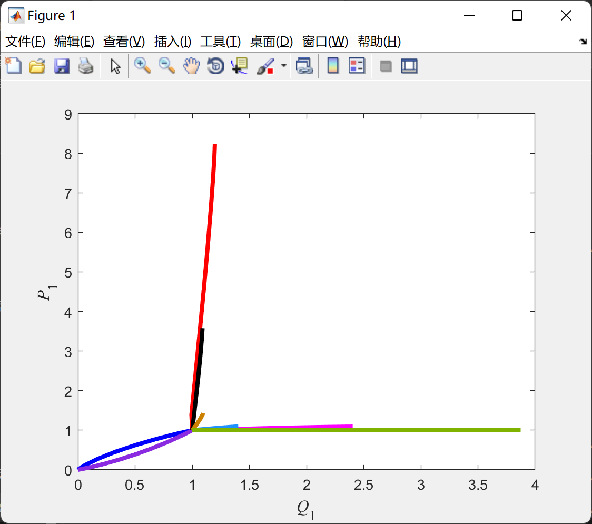
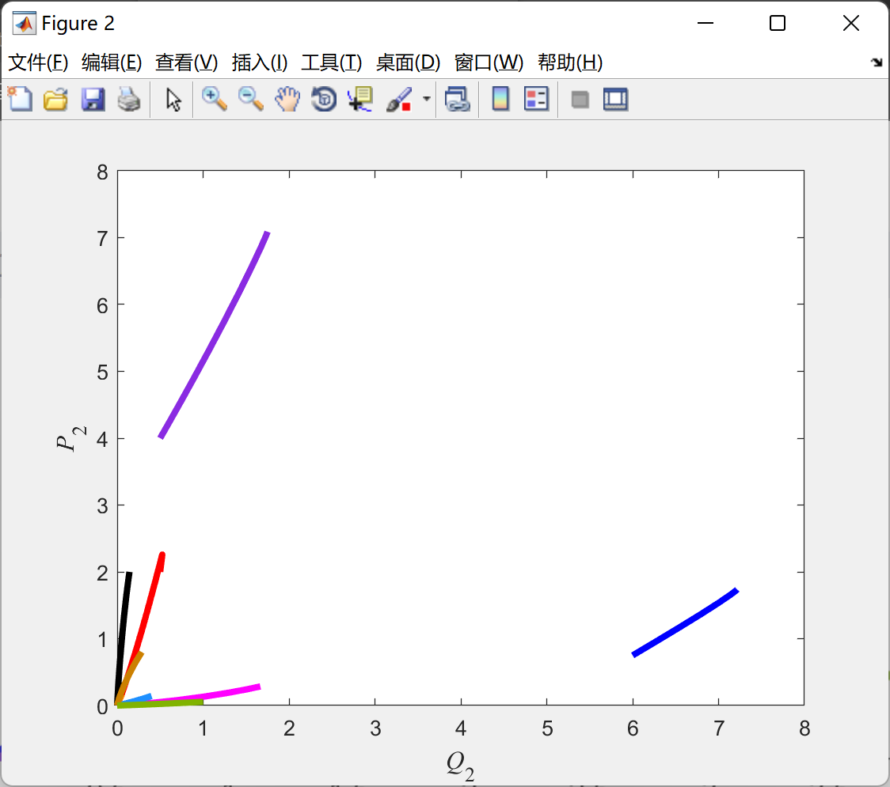
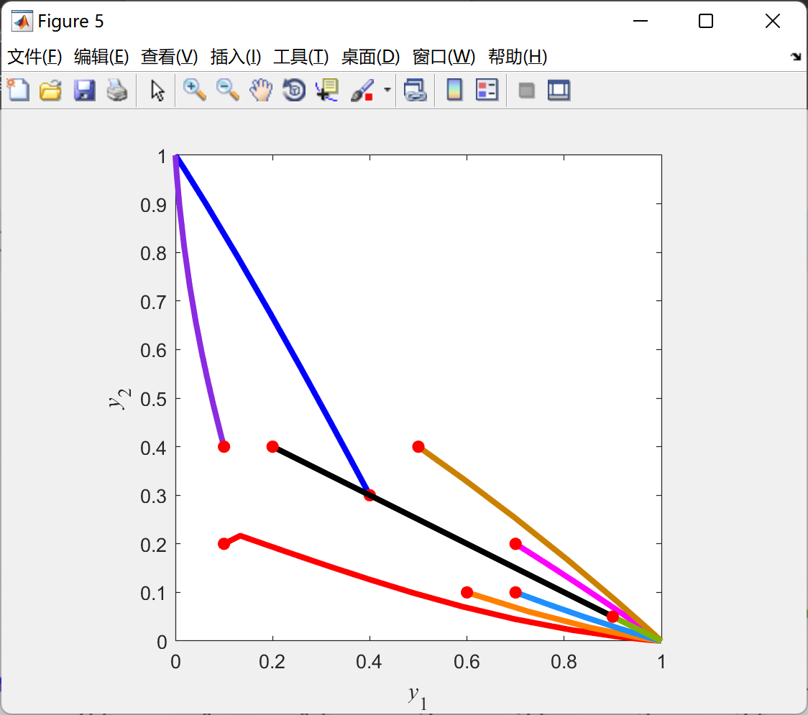

# Gradient Boosting Learning Algorithm (Matlab Code Implementation)

Based on Gradient Boosting Algorithm
clear all;\nclose all;\nclc;\nR = [5 0 0; 0 5 0;0 0 0]; % the payoff matix\n\n\nalpha_jointQ = 0.1; \nalpha = 0.9;        \ngamma = 1;   \nAGENT_COUNT = 2;\nACT_COUNT = 3;\nSTATE_COUNT = 1;\nMAX_UPDATE = 300;\nLINE_WIDTH = 3;\nAGENT1 = 1;\nAGENT2 = 2;\nN = 200;  \ncurve = {'-r','-g','-b','-c','-m','-y','-k','-w'};\n% xi -- the probability of agent 1 to select the i-th action\n% yi -- the probability of agent 2 to select the i-th action\n% xi = Qi/(Q1+Q2+Q3)  yi = Pi/(P1+P2+P3)\n% Each row of point is [x1,x2,y1,y2]   \npoint = [0.6,0.3,0.1,0.2; 0.9,0.05,0.6,0.1; 0.1,0.6,0.4,0.3; 0.4,0.2,0.1,0.4; 0.3,0.5,0.7,0.2; 0.5,0.2,0.7,0.1; 0.7,0.1,0.2,0.4; 0.7,0.2,0.5,0.4; 0.2,0.2,0.9,0.05];\n[row, column] = size(point);\npointCount = row;\nrand('seed', 1);   \nx = zeros(1,ACT_COUNT);\ny = zeros(1,ACT_COUNT);\ndisp('The converged joint strategy of case 2 is:')\nfor pointNum = 1 : pointCount\n    Q1_his = [];\n    Q2_his = [];\n    Q3_his = [];\n    P1_his = [];\n    P2_his = [];\n    P3_his = [];\n    \n    x1_his = [];\n    x2_his = [];\n    y1_his = [];\n    y2_his = [];\n  \n    dev_a1_his = [];\n    dev_a2_his = [];\n    dev_b1_his = [];\n    dev_b2_his = [];\n    \n    realDev_a1_his = [];\n    realDev_a2_his = [];\n    realDev_b1_his = [];\n    realDev_b2_his = [];\n \n    numfreeVar_his = [];\n    \n    action = ones(1,AGENT_COUNT);   \n    Q = zeros(ACT_COUNT, AGENT_COUNT);  \n    x1 = point(pointNum,1);\n    x2 = point(pointNum,2);\n    y1 = point(pointNum,3);\n    y2 = point(pointNum,4);\n    x = [x1, x2, 1-x1-x2];\n    y = [y1, y2, 1-y1-y2];\n    \n    Q(1,AGENT1) = 1;  \n    Q(2,AGENT1) = Q(1,AGENT1)*(x2/x1);\n    Q(3,AGENT1) = Q(1,AGENT1)/x1-Q(1,AGENT1)-Q(2,AGENT1);\n    Q(1,AGENT2) = 1;  \n    Q(2,AGENT2) = Q(1,AGENT2)*(y2/y1);\n    Q(3,AGENT2) = Q(1,AGENT2)/y1-Q(1,AGENT2)-Q(2,AGENT2);\n    max_r_state = -inf; \n    jointQ = zeros(ACT_COUNT, ACT_COUNT);      \n    for step = 1 : MAX_UPDATE\n        if step ~= 1\n            Q = UpdateQ(Q, devQ, alpha, AGENT_COUNT, ACT_COUNT);\n        end\n        Q1_his = [Q1_his;Q(1,AGENT1)];  \n        Q2_his = [Q2_his;Q(2,AGENT1)];\n        Q3_his = [Q3_his;Q(3,AGENT1)];\n        P1_his = [P1_his;Q(1,AGENT2)];\n        P2_his = [P2_his;Q(2,AGENT2)];\n        P3_his = [P3_his;Q(3,AGENT2)];\n        x1 = Q(1,AGENT1)/(sum(Q(:,AGENT1)));\n        x2 = Q(2,AGENT1)/(sum(Q(:,AGENT1)));\n        y1 = Q(1,AGENT2)/(sum(Q(:,AGENT2)));\n        y2 = Q(2,AGENT2)/(sum(Q(:,AGENT2)));\n        x = [x1, x2, 1-x1-x2];\n        y = [y1, y2, 1-y1-y2];\n        \n        x1_his = [x1_his;x1];\n        x2_his = [x2_his;x2];\n        y1_his = [y1_his;y1];\n        y2_his = [y2_his;y2];\n   \n        for sampleCount = 1 : N\n           [max_r_state, jointQ] = PlayAGame(R, max_r_state, jointQ, alpha_jointQ,Q,ACT_COUNT, AGENT_COUNT); \n        end\n        devQ = zeros(ACT_COUNT, AGENT_COUNT);  \n        realDev = zeros(ACT_COUNT, AGENT_COUNT); \n        devQ = EvaluateDevQ(devQ, max_r_state, jointQ, Q, ACT_COUNT, AGENT_COUNT);\n        \n        Q1 = Q(1,AGENT1);\n        Q2 = Q(2,AGENT1);\n        Q3 = Q(3,AGENT1);\n        P1 = Q(1,AGENT2);\n        P2 = Q(2,AGENT2);\n        P3 = Q(3,AGENT2);\n        Q_sum = Q1+Q2+Q3;\n        P = P1+P2+P3;\n        \n        realDev(1,AGENT1) = ((Q2+Q3)/Q_sum^2*P1/P-Q2/Q_sum^2*P2/P);\n        realDev(2,AGENT1) = (-Q1/Q_sum^2*P1/P+(Q1+Q3)/Q_sum^2*P2/P);\n        realDev(1,AGENT2) = ((P2+P3)/P^2*Q1/Q_sum-P2/P^2*Q2/Q_sum);\n        realDev(2,AGENT2) = -P1/P^2*Q1/Q_sum+(P1+P3)/P^2*Q2/Q_sum;\n        \n        realDev_a1_his = [realDev_a1_his;realDev(1,AGENT1)];\n        realDev_a2_his = [realDev_a2_his;realDev(2,AGENT1)];\n        realDev_b1_his = [realDev_b1_his;realDev(1,AGENT2)];\n        realDev_b2_his = [realDev_b2_his;realDev(2,AGENT2)];\n        \n        dev_a1_his = [dev_a1_his;devQ(1,AGENT1)];\n        dev_a2_his = [dev_a2_his;devQ(2,AGENT1)];\n        dev_b1_his = [dev_b1_his;devQ(1,AGENT2)];\n        dev_b2_his = [dev_b2_his;devQ(2,AGENT2)];    \n    end\n  \n    %Agent 1 action 1\n%     figure;\n%     t = 1:MAX_UPDATE;\n%     plot(t, realDev_a1_his-dev_a1_his); \n%     title('Agent 1 action 1 the difference between the real partial derivative and the estimated partial derivative')\n%     grid on;\n%     figure;\n%     plot(t, realDev_a1_his,'r'); \n%     hold on;\n%     plot(t, dev_a1_his,'b'); \n%     title('Agent 1 action 1 the difference between the real partial derivative and the estimated partial derivative')\n%     legend('realDev_a1_his', 'dev_a1_his');\n%     grid on;\n%     hold off;\n%     % Agent 1 action 2\n%     figure;\n%     plot(t, realDev_a2_his-dev_a2_his); \n%     title('Agent 1 action 2 the difference between the real partial derivative and the estimated partial derivative')\n%     grid on;\n%     figure;\n%     plot(t, realDev_a2_his,'r'); \n%     hold on;\n%     plot(t, dev_a2_his,'b'); \n%     title('Agent 1 action 2 the difference between the real partial derivative and the estimated partial derivative')\n%     legend('realDev_a2_his', 'dev_a2_his');\n%     grid on;\n%     hold off;\n    \n    Supplement_f3 = figure(1); \n    if pointNum < 8\n        if pointNum == 2\n            Hl_line = plot(Q1_his(:,1)', P1_his(:,1)','LineWidth',LINE_WIDTH);\n            set(Hl_line,'color',[1,0.5,0]);\n        elseif pointNum == 4\n            Hl_line = plot(Q1_his(:,1)', P1_his(:,1)','LineWidth',LINE_WIDTH);\n            set(Hl_line,'color',[138,43,226]/255.0);\n        elseif pointNum == 6\n            Hl_line = plot(Q1_his(:,1)', P1_his(:,1)','LineWidth',LINE_WIDTH);\n            set(Hl_line,'color',[30,144,255]/255.0);\n        else\n            plot(Q1_his(:,1)', P1_his(:,1)',char(curve(pointNum)),'LineWidth',LINE_WIDTH);\n        end\n    elseif pointNum == 8\n        Hl_line = plot(Q1_his(:,1)', P1_his(:,1)','LineWidth',LINE_WIDTH);\n        set(Hl_line,'color',[0.8,0.5,0]);\n    elseif pointNum == 9\n        Hl_line = plot(Q1_his(:,1)', P1_his(:,1)','LineWidth',LINE_WIDTH);\n        set(Hl_line,'color',[0.5,0.7,0]);\n%     elseif pointNum == 10\n%         Hl_line = plot(Q1_his(:,1)', P1_his(:,1)','LineWidth',LINE_WIDTH);\n%         set(Hl_line,'color',[0.3,0.5,0.6]);  \n%     elseif pointNum == 11\n%         Hl_line = plot(Q1_his(:,1)', P1_his(:,1)','LineWidth',LINE_WIDTH);\n%         set(Hl_line,'color',[0.8,0.2,0.5]);\n%     elseif pointNum == 12\n%         Hl_line = plot(Q1_his(:,1)', P1_his(:,1)','LineWidth',LINE_WIDTH);\n%         set(Hl_line,'color',[180,150,230]/255.0);\n    end\n    hold on;\n    \n    %axis([0 1 0 1]);\n    %axis square;\n    xlabel('\it\fontname{Times New Roman}Q\rm_1', 'fontsize',12);\n    ylabel('\it\fontname{Times New Roman}P\rm_1', 'fontsize',12);\n    \n    Supplement_f4 = figure(2); \n    if pointNum < 8\n        if pointNum == 2\n            Hl_line = plot(Q2_his(:,1)', P2_his(:,1)','LineWidth',LINE_WIDTH);\n            set(Hl_line,'color',[1,0.5,0]);\n        elseif pointNum == 4\n            Hl_line = plot(Q2_his(:,1)', P2_his(:,1)','LineWidth',LINE_WIDTH);\n            set(Hl_line,'color',[138,43,226]/255.0);\n        elseif pointNum == 6\n            Hl_line = plot(Q2_his(:,1)', P2_his(:,1)','LineWidth',LINE_WIDTH);\n            set(Hl_line,'color',[30,144,255]/255.0);\n        else\n            plot(Q2_his(:,1)', P2_his(:,1)',char(curve(pointNum)),'LineWidth',LINE_WIDTH);\n        end\n    elseif pointNum == 8\n        Hl_line = plot(Q2_his(:,1)', P2_his(:,1)','LineWidth',LINE_WIDTH);\n        set(Hl_line,'color',[0.8,0.5,0]);\n    elseif pointNum == 9\n        Hl_line = plot(Q2_his(:,1)', P2_his(:,1)','LineWidth',LINE_WIDTH);\n        set(Hl_line,'color',[0.5,0.7,0]);\n%     elseif pointNum == 10\n%         Hl_line = plot(Q2_his(:,1)', P2_his(:,1)','LineWidth',LINE_WIDTH);\n%         set(Hl_line,'color',[0.3,0.5,0.6]); \n%     elseif pointNum == 11\n%         Hl_line = plot(Q2_his(:,1)', P2_his(:,1)','LineWidth',LINE_WIDTH);\n%         set(Hl_line,'color',[0.8,0.2,0.5]);\n%     elseif pointNum == 12\n%         Hl_line = plot(Q2_his(:,1)', P2_his(:,1)','LineWidth',LINE_WIDTH);\n%         set(Hl_line,'color',[180,150,230]/255.0);\n    end\n    hold on;\n    %axis([0 1 0 1]);\n    %axis square;\n    xlabel('\it\fontname{Times New Roman}Q\rm_2', 'fontsize',12);\n    ylabel('\it\fontname{Times New Roman}P\rm_2', 'fontsize',12);\n    \n    \n    Supplement_f5 = figure(3); \n    if pointNum < 8\n        if pointNum == 2\n            Hl_line = plot(Q3_his(:,1)', P3_his(:,1)','LineWidth',LINE_WIDTH);\n            set(Hl_line,'color',[1,0.5,0]);\n        elseif pointNum == 4\n            Hl_line = plot(Q3_his(:,1)', P3_his(:,1)','LineWidth',LINE_WIDTH);\n            set(Hl_line,'color',[138,43,226]/255.0);\n        elseif pointNum == 6\n            Hl_line = plot(Q3_his(:,1)', P3_his(:,1)','LineWidth',LINE_WIDTH);\n            set(Hl_line,'color',[30,144,255]/255.0);\n        else\n            plot(Q3_his(:,1)', P3_his(:,1)',char(curve(pointNum)),'LineWidth',LINE_WIDTH);\n        end\n    elseif pointNum == 8\n        Hl_line = plot(Q3_his(:,1)', P3_his(:,1)','LineWidth',LINE_WIDTH);\n        set(Hl_line,'color',[0.8,0.5,0]);\n    elseif pointNum == 9\n        Hl_line = plot(Q3_his(:,1)', P3_his(:,1)','LineWidth',LINE_WIDTH);\n        set(Hl_line,'color',[0.5,0.7,0]);\n%     elseif pointNum == 10\n%         Hl_line = plot(Q3_his(:,1)', P3_his(:,1)','LineWidth',LINE_WIDTH);\n%         set(Hl_line,'color',[0.3,0.5,0.6]);   \n%     elseif pointNum == 11\n%         Hl_line = plot(Q3_his(:,1)', P3_his(:,1)','LineWidth',LINE_WIDTH);\n%         set(Hl_line,'color',[0.8,0.2,0.5]);\n%     elseif pointNum == 12\n%         Hl_line = plot(Q3_his(:,1)', P3_his(:,1)','LineWidth',LINE_WIDTH);\n%         set(Hl_line,'color',[180,150,230]/255.0);\n    end\n    hold on;\n    \n    %axis([0 1 0 1]);\n    %axis square;\n    xlabel('\it\fontname{Times New Roman}Q\rm_3', 'fontsize',12);\n    ylabel('\it\fontname{Times New Roman}P\rm_3', 'fontsize',12);\n    \n    f4 = figure(4); \n    if pointNum < 8\n        if pointNum == 2\n            Hl_line = plot(x1_his(:,1)', x2_his(:,1)','LineWidth',LINE_WIDTH);\n            set(Hl_line,'color',[1,0.5,0]);\n        elseif pointNum == 4\n            Hl_line = plot(x1_his(:,1)', x2_his(:,1)','LineWidth',LINE_WIDTH);\n            set(Hl_line,'color',[138,43,226]/255.0);\n        elseif pointNum == 6\n            Hl_line = plot(x1_his(:,1)', x2_his(:,1)','LineWidth',LINE_WIDTH);\n            set(Hl_line,'color',[30,144,255]/255.0);\n        else\n            plot(x1_his(:,1)', x2_his(:,1)',char(curve(pointNum)),'LineWidth',LINE_WIDTH);\n        end\n    elseif pointNum == 8\n        Hl_line = plot(x1_his(:,1)', x2_his(:,1)','LineWidth',LINE_WIDTH);\n        set(Hl_line,'color',[0.8,0.5,0]);\n    elseif pointNum == 9\n        Hl_line = plot(x1_his(:,1)', x2_his(:,1)','LineWidth',LINE_WIDTH);\n        set(Hl_line,'color',[0.5,0.7,0]);\n%     elseif pointNum == 10\n%         Hl_line = plot(x1_his(:,1)', x2_his(:,1)','LineWidth',LINE_WIDTH);\n%         set(Hl_line,'color',[0.3,0.5,0.6]);\n%     elseif pointNum == 11\n%         Hl_line = plot(x1_his(:,1)', x2_his(:,1)','LineWidth',LINE_WIDTH);\n%         set(Hl_line,'color',[0.8,0.2,0.5]);\n%     elseif pointNum == 12\n%         Hl_line = plot(x1_his(:,1)', x2_his(:,1)','LineWidth',LINE_WIDTH);\n%         set(Hl_line,'color',[180,150,230]/255.0);\n    end\n    hold on;\n    plot(point(pointNum,1),point(pointNum,2), 'o','MarkerFaceColor','r','MarkerEdgeColor','r');\n    \n    axis([0 1 0 1]);\n    axis square;\n    xlabel('\it\fontname{Times New Roman}x\rm_1', 'fontsize',12);\n    ylabel('\it\fontname{Times New Roman}x\rm_2', 'fontsize',12);\n    \n    f5 = figure(5);\n    if pointNum < 8\n        if pointNum == 2\n            Hl_line = plot(y1_his(:,1)', y2_his(:,1)','LineWidth',LINE_WIDTH);\n            set(Hl_line,'color',[1,0.5,0]);\n        elseif pointNum == 4\n            Hl_line = plot(y1_his(:,1)', y2_his(:,1)','LineWidth',LINE_WIDTH);\n            set(Hl_line,'color',[138,43,226]/255.0);\n        elseif pointNum == 6\n            Hl_line = plot(y1_his(:,1)', y2_his(:,1)','LineWidth',LINE_WIDTH);\n            set(Hl_line,'color',[30,144,255]/255.0);\n        else\n            plot(y1_his(:,1)', y2_his(:,1)',char(curve(pointNum)),'LineWidth',LINE_WIDTH);\n        end\n    elseif pointNum == 8\n        Hl_line = plot(y1_his(:,1)', y2_his(:,1)','LineWidth',LINE_WIDTH);\n        set(Hl_line,'color',[0.8,0.5,0]);\n    elseif pointNum == 9\n        Hl_line = plot(y1_his(:,1)', y2_his(:,1)','LineWidth',LINE_WIDTH);\n        set(Hl_line,'color',[0.5,0.7,0]);\n%     elseif pointNum == 10\n%         Hl_line = plot(y1_his(:,1)', y2_his(:,1)','LineWidth',LINE_WIDTH);\n%         set(Hl_line,'color',[0.3,0.5,0.6]);\n%     elseif pointNum == 11\n%         Hl_line = plot(y1_his(:,1)', y2_his(:,1)','LineWidth',LINE_WIDTH);\n%         set(Hl_line,'color',[0.8,0.2,0.5]);\n%     elseif pointNum == 12\n%         Hl_line = plot(y1_his(:,1)', y2_his(:,1)','LineWidth',LINE_WIDTH);\n%         set(Hl_line,'color',[180,150,230]/255.0);\n    end\n    hold on;\n    % Plot the initial points.\n    plot(point(pointNum,3),point(pointNum,4), 'o','MarkerFaceColor','r','MarkerEdgeColor','r');\n    \n    axis([0 1 0 1]);\n    axis square;\n    xlabel('\it\fontname{Times New Roman}y\rm_1', 'fontsize',12);\n    ylabel('\it\fontname{Times New Roman}y\rm_2', 'fontsize',12);\n    c = 0\n   \n    x  % show the converged probability distribution of action selection for agent 1\n    y  % show the converged probability distribution of action selection for agent 2\n%     \n% \n%     \n%     figure(pointNum+3);\n%     step = 1:MAX_STEP;\n%     plot(step, p1_his(:,1),'-ro');\n%     hold on;\n%     plot(step, p2_his(:,1),'-.bx');\nend\n\n\nsaveas(f4, 'fig4.png')\nsaveas(f5, 'fig5.png')\nsaveas(Supplement_f3, 'Supplement_fig3.png')\nsaveas(Supplement_f4, 'Supplement_fig4.png')\nsaveas(Supplement_f5, 'Supplement_fig5.png')\n\n        \n      \n        \n      \n        \n  

## Images

<!-- PAYMENT_BLOCK -->

## Get this dataset

- Payment link (Stripe): [Buy now](https://buy.stripe.com/3cs8yP7sY87d0vu9AB)
- Payment QR code: 

<!-- /PAYMENT_BLOCK -->
